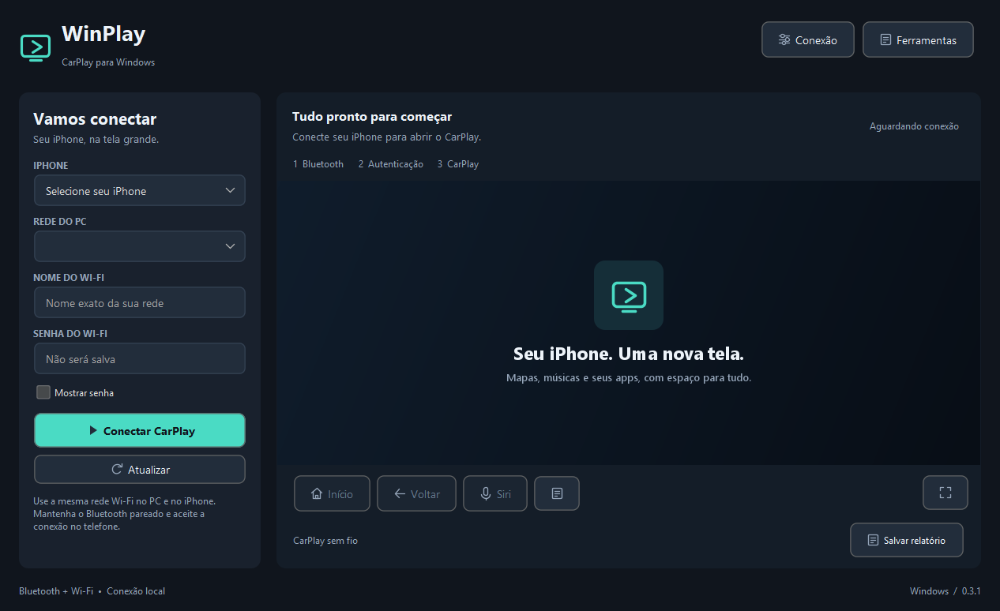

# WinPlay

CarPlay sem fio na tela do Windows.

O WinPlay conecta o iPhone ao computador por Bluetooth e Wi-Fi para exibir o CarPlay em uma janela ou em tela cheia, com áudio, comandos de navegação e acesso à Siri.



## Recursos

- Interface escura com painel de conexão recolhível.
- Vídeo H.264, reprodução de áudio e entrada de microfone.
- Controles de Início, Voltar e Siri.
- Tela cheia com F11 e retorno com Esc.
- Preferências de iPhone, interface de rede e nome do Wi-Fi.
- Histórico técnico recolhível e exportação de relatórios.
- Pacote portátil com runtime incluído.

## Começar

1. Extraia o pacote portátil inteiro em uma pasta com permissão de escrita.
2. Abra **WinPlay.exe**. Mantenha as pastas `app` e `runtime` ao lado dele.
3. Pareie o iPhone no Bluetooth do Windows.
4. Conecte o PC e o iPhone à mesma rede Wi-Fi.
5. No WinPlay, selecione **iPhone** e **Rede do PC**; informe **Nome do Wi-Fi** e **Senha do Wi-Fi**.
6. Clique em **Conectar CarPlay** e aceite os pedidos apresentados no iPhone.

Não é necessário instalar Java para usar o pacote portátil. A primeira preparação de autenticação requer acesso à internet. A senha do Wi-Fi não é gravada nas preferências.

## Requisitos e compatibilidade

- Windows x64 com Bluetooth funcional e interface IPv4 ativa.
- iPhone com CarPlay sem fio e Bluetooth pareado.
- Rede que permita comunicação entre o PC e o iPhone.
- Saída de áudio e, para Siri, microfone acessível ao aplicativo.

A conexão foi confirmada em um iPhone 15 Pro Max com iOS 27 na base de conexão utilizada pelo projeto. A interface e a mudança de nome da versão 0.3.1 passaram por validação local. Isso não representa uma certificação de compatibilidade com todos os dispositivos. Conexão USB e criação automática de hotspot não estão implementadas.

## Documentação

| Assunto | Guia |
| --- | --- |
| Instalação, atualização e primeiro uso | [Instalação](docs/INSTALACAO.md) |
| Interface e atalhos | [Manual do usuário](docs/USO.md) |
| Rede, preferências e autenticação | [Configuração](docs/CONFIGURACAO.md) |
| Diagnóstico de conexão, áudio e vídeo | [Solução de problemas](docs/SOLUCAO-DE-PROBLEMAS.md) |
| Compilar, testar e empacotar | [Desenvolvimento](docs/DESENVOLVIMENTO.md) |
| Organização interna | [Arquitetura](docs/ARQUITETURA.md) |
| Conferência de versões | [Validação](docs/VALIDACAO.md) |
| Dados locais e relatórios | [Privacidade](docs/PRIVACIDADE.md) |
| Alterações por versão | [Changelog](CHANGELOG.md) |

## Compilar

No PowerShell, com JDK 21 x64 e Kotlin 2.2.10 disponíveis:

```powershell
.\build.ps1 -Jdk 'C:\ferramentas\jdk-21' -Kotlin 'C:\ferramentas\kotlinc' -Package
```

O resultado fica em `build/package-<data-hora>/WinPlay/WinPlay.exe`. As bibliotecas usadas pelo build estão em `lib/`; os testes são executados antes do empacotamento.

## Manutenção

Mantido por **Pedro Pandolfi**. Para relatar um problema, descreva as versões do aplicativo, Windows e iOS, a etapa em que ocorreu e os passos para reproduzir. Revise os relatórios antes de anexá-los.

## Licença

Distribuído sob [GPL-3.0](LICENSE). Os avisos de componentes, origens e licenças estão em [THIRD-PARTY-NOTICES.md](THIRD-PARTY-NOTICES.md), [UPSTREAM.txt](UPSTREAM.txt) e `licenses/`.

CarPlay, iPhone, Siri e Apple são marcas de seus respectivos titulares. O WinPlay é um aplicativo independente, sem afiliação ou certificação Apple.
