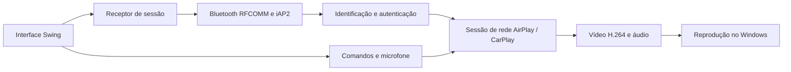

# Arquitetura

## Fluxo de uma sessão

Bluetooth e rede atendem etapas diferentes. A interface só considera a reprodução iniciada quando recebe o primeiro quadro de vídeo.

## Diretórios

| Caminho | Responsabilidade |
| --- | --- |
| `src/main` | Interface, integração Windows e ciclo de sessão |
| `src/native` | Integração Java com codecs FFmpeg/JavaCPP |
| `src/upstream` | Componentes de protocolo mantidos com procedência registrada |
| `src/adapted` | Componentes ajustados ao ambiente desktop |
| `src/test` | Testes de protocolo, codecs, Windows e interface |
| `lib` | Bibliotecas do build e da execução |
| `assets` | Ícones e outros recursos |
| `licenses` | Textos de licenças dos componentes |
| `docs` | Guias de uso, manutenção e validação |

## Componentes principais

`Desktop` inicializa o tema, a janela e os modos de linha de comando. `ReceiverPanel` coordena os campos de conexão, o estado visual e os controles. `DiagnosticsDialog` disponibiliza as verificações operacionais.

`DesktopReceiver` abre os recursos de sessão e coordena Bluetooth, identificação, autenticação e serviços de rede. `WindowsRfcomm` integra o socket Bluetooth; `WindowsBluetooth` consulta rádios e dispositivos.

`WindowsMediaSink` recebe as mídias para reprodução. `NativeCodecs` implementa a fronteira Java com FFmpeg/JavaCPP. `IdentityProvisioner` prepara a autenticação com verificação do artefato de origem.

## Concorrência e estado visual

A interface Swing é atualizada no EDT. A consulta de dispositivos, a preparação e o fechamento de recursos ficam fora dessa thread. Cada tentativa recebe um identificador de geração; retornos de tentativas encerradas são descartados antes de atualizar a interface ou enviar controles.

O vídeo solicita repintura independentemente do temporizador do histórico. O histórico é limitado em entradas e caracteres e só é copiado para o componente visual quando aberto. Eventos de movimento do ponteiro são agrupados para reduzir acúmulo de comandos.

## Persistência

Preferências de interface, identidade do receptor, pareamentos e autenticação permanecem no diretório local da aplicação. Esse diretório fica fora do repositório. A seleção de rede pode mudar entre execuções; restaurar o último endereço não garante que ele ainda seja válido.

## Limites

O projeto implementa um receptor sem fio para Windows. Não implementa conexão USB, hotspot automático ou garantia de funcionamento em qualquer combinação de rádio, rede e versão de iOS.
